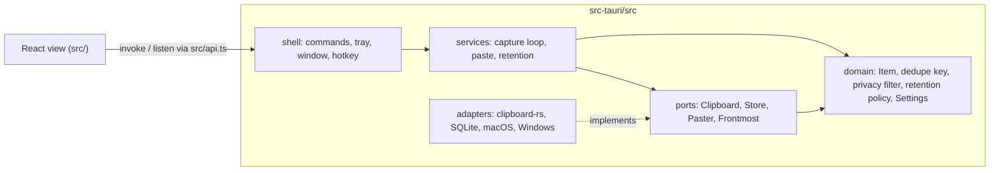
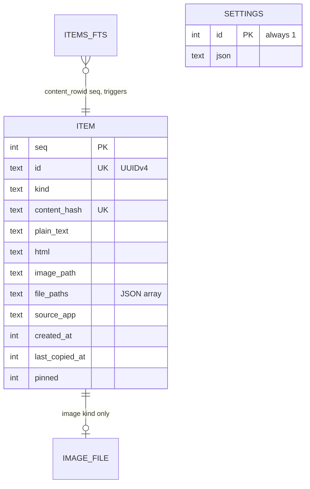

# Architecture Spine — Magpie MVP

## Design Paradigm

Hexagonal inside `src-tauri/src/`. The domain is pure Rust with no Tauri, OS or SQLite types; ports are traits; adapters implement them; the Tauri shell wires adapters to the domain and exposes commands. The React frontend is a view over the shell's commands and events.



Arrows are allowed dependencies. Nothing depends on `shell`; `domain` depends on nothing.

## Invariants & Rules

### AD-1 — Ports and adapters [ADOPTED]

- **Binds:** all
- **Prevents:** OS, Tauri or SQLite types leaking into logic that must be unit-tested against fakes.
- **Rule:** The OS clipboard, storage, synthetic paste and frontmost-app lookup are traits in `ports/`. Domain and services take them as generics or `dyn` and never name a concrete adapter. Every port has an in-memory fake under `#[cfg(test)]`.

### AD-2 — Rust is the single writer

- **Binds:** CAP-1, CAP-2, CAP-6, CAP-8, CAP-10
- **Prevents:** UI-side caches drifting from the database.
- **Rule:** Only Rust mutates history and settings. The frontend changes state only by calling a command. After every mutation the backend emits `history-changed` (or `settings-changed`), and the UI refetches instead of patching local state.

### AD-3 — Stable identity and one dedupe key

- **Binds:** CAP-1, CAP-2, CAP-6
- **Prevents:** ID churn that would break future sync, and two different notions of "same content".
- **Rule:** An item gets a UUIDv4 `id` at first capture that never changes. The dedupe key is SHA-256 over `kind` (AD-13) plus the canonical payload: text as UTF-8; HTML as its plain-text form plus the HTML; images as decoded RGBA bytes; files as newline-joined absolute paths. A dedupe hit from an external copy updates `last_copied_at` and `source_app` on the existing row and keeps `id` and `pinned`. Magpie's own writes never change `source_app` (AD-7).

### AD-4 — Time

- **Binds:** all
- **Prevents:** Mixed time units and timezones between the database, DTOs and retention.
- **Rule:** Timestamps are `i64` Unix milliseconds UTC everywhere. History is ordered by `last_copied_at` descending. The UI formats times in local time.

### AD-5 — Images on disk, owned by the store

- **Binds:** CAP-1, CAP-8
- **Prevents:** Blobs in SQLite and orphaned image files.
- **Rule:** Image data is a PNG at `<root>/images/<id>.png` (AD-16), and the row stores the relative path. Only the `Store` creates or deletes these files. Removing a row deletes its file after the transaction commits. A startup sweep deletes any file in `images/` with no row.

### AD-6 — Privacy filter before content read

- **Binds:** CAP-7
- **Prevents:** Reading or logging secrets before deciding to skip them.
- **Rule:** `domain::privacy::should_capture(formats, markers, source_app, paused, ignored_apps)` is a pure function evaluated before any content payload is read. It may use the list of available formats, the source app and the values of marker formats (such as the `CanIncludeInClipboardHistory` DWORD). Concealed markers (`org.nspasteboard.ConcealedType`, `org.nspasteboard.TransientType`, `ExcludeClipboardContentFromMonitorProcessing`, `CanIncludeInClipboardHistory` = 0) mean skip.

### AD-7 — Magpie's own writes are not captures

- **Binds:** CAP-1, CAP-5
- **Prevents:** Paste-back re-recording the item as a new copy from Magpie.
- **Rule:** The paste service moves the item to the top itself (`last_copied_at` = now, `source_app` unchanged), writes the clipboard, then records the OS clipboard sequence number after its write (macOS `NSPasteboard.changeCount`, Windows `GetClipboardSequenceNumber`). The capture loop drops any change whose sequence number is at or below the recorded one. Content matching and "skip the next change" flags are not used.

### AD-8 — Search in Rust over FTS5

- **Binds:** CAP-4
- **Prevents:** Client-side filtering, and search behaving differently in different places.
- **Rule:** An FTS5 table (`tokenize = 'unicode61 remove_diacritics 2'`, `content_rowid = seq`) indexes the plain-text form of every text, HTML and file item, kept in sync by triggers. The query is each user token as a quoted prefix term, ANDed. An empty query returns the recency list. One `search` command serves both the main view and the pinned view, through a `pinned_only` flag.

### AD-9 — Command and DTO contract

- **Binds:** all
- **Prevents:** Naming and shape drift across the Rust/TypeScript boundary.
- **Rule:** Tauri commands are snake_case verbs (`list_items`, `search`, `paste_item`, `set_pinned`, `delete_item`, `get_settings`, `update_settings`). DTOs use `#[serde(rename_all = "camelCase")]`. Errors cross the boundary as `AppError` (AD-14), serialised as a readable string. Events are `history-changed`, `settings-changed` and `window-shown` (AD-17). `src/api.ts` is the only frontend module that calls `invoke` or `listen`, and it mirrors the DTOs as TypeScript types.

### AD-10 — Settings

- **Binds:** CAP-3, CAP-7, CAP-8, CAP-9, CAP-10
- **Prevents:** Settings scattered across files and partial applies.
- **Rule:** One typed `Settings` struct with defaults (including `paused` and `ignored_apps`), stored as JSON in one row of the `settings` table. `SettingsService` (`Arc<RwLock<Settings>>`) is its only in-memory owner. The tray, the commands and the hotkey change settings only through `SettingsService::update`, which validates, applies side effects, writes through to the store and emits `settings-changed`. A hotkey change registers the new shortcut before unregistering the old one. If any step fails, it returns a readable error and the previous settings stay in force. The capture loop reads a snapshot from the service on each change, never from the database. `paused` persists across restarts.

### AD-11 — Concurrency

- **Binds:** CAP-1, CAP-4
- **Prevents:** Two writers racing on the database connection.
- **Rule:** The capture watcher runs on its own thread. The store is `Arc<Mutex<SqliteStore>>` in Tauri managed state, shared by the watcher and the commands. Locks are held for one store operation only, never across OS calls or a sleep.

### AD-12 — Paste-back sequence

- **Binds:** CAP-5
- **Prevents:** Pasting into Magpie's own window or the wrong app.
- **Rule:** The frontmost app is recorded when the hotkey shows the window, before focus moves. The paste order is: write clipboard (AD-7), hide window, reactivate the saved app, wait until it is frontmost (timeout about 300 ms), synthetic Cmd/Ctrl+V. On macOS 14+ reactivation uses cooperative activation (`NSApp.yieldActivationToApplication` then activate the saved `NSRunningApplication`), because `ActivateIgnoringOtherApps` no longer has any effect. On Windows it uses `SetForegroundWindow` on the saved window, then `SendInput`. If the paste permission is missing, it copies only and returns `PasteOutcome::CopiedOnly` so the UI can say "copied, press paste yourself".

### AD-13 — Kind precedence for multi-format copies

- **Binds:** CAP-1, CAP-2, CAP-3, CAP-5
- **Prevents:** The same copy being classified differently by different units, which changes its dedupe key and paste-back.
- **Rule:** An item's `kind` is the first present in `files` > `image` > `html` > `text`. Every available representation is stored (plain text whenever present), and paste-back writes all stored representations to the clipboard together.

### AD-14 — Error layering

- **Binds:** all
- **Prevents:** Tauri types leaking into the domain via the error type, against AD-1.
- **Rule:** `domain`, `ports`, `adapters` and `services` return `CoreError` (`thiserror`, no Tauri types). `shell::AppError` wraps `CoreError` and `tauri::Error` via `From` and is the only error type commands return.

### AD-15 — Retention timing

- **Binds:** CAP-8, CAP-10
- **Prevents:** Units ageing by different timestamps, and new limits waiting for a restart.
- **Rule:** Age is measured on `last_copied_at`. `services::retention::run` executes at startup, after each insert, after any settings change to the limits, and hourly. It deletes in one transaction, then removes the image files (AD-5), then emits `history-changed`.

### AD-16 — Storage location and schema keys

- **Binds:** CAP-1, CAP-3, CAP-4, CAP-8
- **Prevents:** Roaming a large local database, an FTS index broken by `VACUUM` renumbering, and three ways of sending images to the UI.
- **Rule:** The root is Tauri's `app_local_data_dir()`. The database is `<root>/magpie.db` and images live under `<root>/images/`. `items` has `seq INTEGER PRIMARY KEY` plus `id TEXT UNIQUE`, and FTS uses `content_rowid = seq`. `INSERT OR REPLACE` is never used on `items`. List DTOs carry a plain-text preview of at most 200 characters and, for images, an `imageUrl` served by the asset protocol, scoped to `<root>/images/**` only.

### AD-17 — UI selection and window events

- **Binds:** CAP-3
- **Prevents:** The selection jumping when a capture lands, and stale queries when the window reopens.
- **Rule:** The UI keeps its selection by item `id`, not index. When the hotkey shows the window, the backend emits `window-shown`, and the UI then resets the query and selects the first item.

### AD-18 — Startup and supervision

- **Binds:** CAP-1, CAP-3, CAP-8, CAP-10
- **Prevents:** Capture starting before migrations or settings, and a dead watcher thread going unnoticed.
- **Rule:** Startup order: open DB → migrate → orphan sweep → retention → load settings → register hotkey from settings → start watcher. Whatever is on the clipboard at launch is not captured. The watcher runs under `catch_unwind` and restarts with backoff if it panics.

## Consistency Conventions

| Concern | Convention |
| --- | --- |
| Item kinds | `text`, `html`, `image`, `files` (lowercase string in DB and DTO) |
| Rust modules | `domain/`, `ports/`, `adapters/<os or tech>/`, `services/`, `shell/`; one concept per file |
| OS-specific code | `#[cfg(target_os = ...)]` only inside `adapters/`; shell and services stay cfg-free except for wiring |
| Errors | `CoreError` below the shell, `AppError` in the shell (AD-14); no `unwrap()`/`expect()` outside tests on OS or disk paths |
| Logging | `eprintln!` for now, never clipboard contents |
| Schema changes | `PRAGMA user_version` with ordered migration steps in `adapters/sqlite/migrations.rs` |
| Frontend | function components and hooks; no state library; types in `src/api.ts` |

## Stack

| Name | Version |
| --- | --- |
| Tauri | 2.12.5 |
| tauri-plugin-global-shortcut | 2.4.1 |
| tauri-plugin-single-instance | 2.5.5 |
| tauri-plugin-autostart (`MacosLauncher::LaunchAgent`) | 2.7 |
| rusqlite (bundled, FTS5) | =0.42.0 |
| clipboard-rs (default features, incl. `image`) | 0.3.5 |
| objc2-app-kit / objc2-core-graphics / objc2-application-services | 0.3 |
| windows | 0.62 |
| React / TypeScript / Vite | 19 / 6.0 (7.x deferred until toolchain compatibility is checked) / 8 |

## Structural Seed

```text
src-tauri/src/
  domain/      # Item, ItemKind, dedupe key, privacy filter, retention policy, Settings
  ports/       # Clipboard, Store, Paster, Frontmost traits (+ test fakes)
  adapters/
    sqlite/    # SqliteStore, migrations, FTS
    clipboard/ # clipboard-rs watcher and reader
    macos/     # frontmost app, Accessibility, CGEvent paste
    windows/   # clipboard owner, SendInput paste
  services/    # capture loop, paste, retention
  shell/       # commands, tray, window, hotkey, error
src/
  api.ts       # the only invoke/listen caller
  components/  # list, previews, search, settings, permission flow
```



## Capability → Architecture Map

| Capability | Lives in | Governed by |
| --- | --- | --- |
| CAP-1 capture | services/capture, adapters/clipboard | AD-1, AD-3, AD-6, AD-7, AD-11, AD-13, AD-18 |
| CAP-2 dedupe | domain (key), adapters/sqlite (upsert) | AD-3 |
| CAP-3 history window | shell/window, shell/hotkey, src/components | AD-2, AD-9, AD-16, AD-17 |
| CAP-4 search | adapters/sqlite (FTS5) | AD-8 |
| CAP-5 paste-back | services/paste, adapters/macos, adapters/windows | AD-7, AD-12, AD-13 |
| CAP-6 pins | adapters/sqlite, shell commands | AD-2, AD-3 |
| CAP-7 privacy | domain/privacy, services/capture | AD-6, AD-10 |
| CAP-8 retention | domain (policy), services/retention, adapters/sqlite | AD-5, AD-15, AD-16 |
| CAP-9 tray | shell/tray | AD-10 |
| CAP-10 settings | domain/Settings, shell commands, src/components | AD-10 |

## Deferred

- Linux adapters: after the MVP. The ports already isolate them.
- Sync, encryption at rest, multi-device identity: out of scope. UUIDs (AD-3) and the `Store` trait keep the door open.
- Packaging and signing (notarisation, Authenticode): stage g, and only once the owner provides signing material; it is never committed.
- Deployment and infrastructure: none. The app is local-only and makes no network calls.
